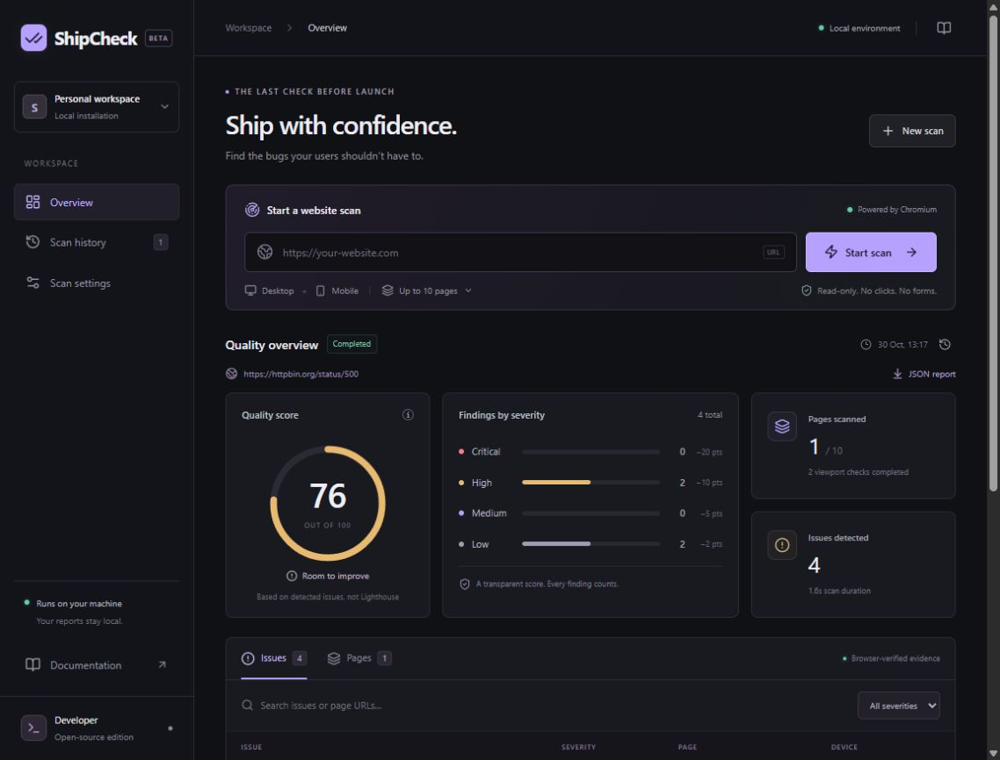

# ShipCheck

**Prototype · v0.1.0** — A working local MVP for experimentation and feedback. APIs and report formats may change; this version is not intended for public multi-user hosting.

A real-browser website QA tool for the last check before launch. Enter a public URL, inspect recorded defects, and leave with screenshots and a portable report. No paid API key is needed to scan.

ShipCheck is an npm workspace monorepo built with TypeScript, Next.js App Router, Tailwind CSS, Playwright Chromium, Zod, and Vitest. It is a local developer tool, not a hosted multi-user service.

## What it checks

- Same-origin internal links, unexpected HTTP 4xx/5xx responses, JavaScript exceptions, and console errors.
- Desktop (1440 × 900) and mobile (375 × 812) rendering; obvious horizontal mobile overflow.
- Issue screenshots, HTTP status, error messages/stacks when available, viewport and source-link evidence.
- Bounded breadth-first crawling (10 pages by default; maximum 30), with duplicate URLs removed.
- Deterministic quality scoring, local history, filterable findings, and JSON downloads.
- CLI JSON and self-contained HTML markup with adjacent screenshot files.
- Optional OpenAI explanations of individual recorded issues, clearly identified as hypotheses.

The dashboard intentionally starts empty. It never displays seeded or invented scan results. This is an issue-based quality score, **not a Lighthouse or Web Vitals score**.

## Quick start

Prerequisites: Node.js 20.9+ (Node 22 or 24 LTS recommended), npm, and enough disk space for Chromium. Use a persistent local Node process and a writable filesystem.

```sh
npm install
npm run browsers:install
npm run dev
```

Open http://127.0.0.1:3000. Paste a full public `https://` or `http://` URL and select **Start scan**. The dashboard polls progress while Chromium works. Choose **Scan settings** to change the page limit or disable mobile checks. Review issue details and screenshots; use **JSON report** to download the evidence. **Scan history** revisits local reports.

On Linux CI/minimal systems, install browser OS dependencies with:

```sh
npx playwright install --with-deps chromium
```

Production on your own machine:

```sh
npm run build
npm start
```

Both servers bind to `127.0.0.1`. Requests with nonlocal Host headers are rejected. Do not expose this unauthenticated MVP to the internet.

## CLI

Run from the repository root:

```sh
npm run scan -- https://www.wikipedia.org --max-pages 10 --mobile --output ./reports
npm run scan -- https://www.wikipedia.org --max-pages 2 --desktop-only
npm run scan -- --help
```

Mobile checks are enabled by default; `--mobile` is explicit and `--desktop-only` disables them. Reports are written to `<output>/<scan-id>/report.json` and `report.html`, with PNGs under `screenshots/`. Keep that folder intact when sharing the HTML report. Paths are relative to the directory where the CLI is invoked. A failed scan or invalid input exits 1; a scan with findings exits 0 and reports the findings. Partial scans explicitly identify incomplete coverage.

## Optional AI explanations

Create `apps/web/.env.local` (ignored by Git) using `.env.example` as a guide:

```dotenv
OPENAI_API_KEY=your-key-here
OPENAI_MODEL=gpt-4.1-mini
```

Restart the dashboard. Open an issue and select **Explain this issue**. It sends only the selected issue's type, severity, viewport, description and evidence to the [OpenAI Responses API](https://developers.openai.com/api/docs/guides/text). URLs in recorded evidence and error messages may contain sensitive information: review them before using the optional button. Screenshots, other findings, and the rest of the report are not sent. Responses are requested with `store: false`; OpenAI's account/data policies still apply. Model access and billing depend on your account. No key means a clear setup message, with normal scanning unaffected. The UI separates observed evidence from AI suggestions; verifying a fix requires a new scan.

## Scoring

For each deduplicated finding:

| Severity | Deduction | Current examples                                   |
| -------- | --------: | -------------------------------------------------- |
| Critical |        20 | Reserved for future checkers                       |
| High     |        10 | JavaScript exception, HTTP 5xx, navigation failure |
| Medium   |         5 | HTTP 4xx, broken internal link, mobile overflow    |
| Low      |         2 | Browser console error                              |

`score = max(0, min(100, 100 - sum(deductions)))`.

Deduplication keys include page URL, viewport, issue type, affected URL, status, and message (or description). Identical inputs produce identical IDs and scores regardless of ordering. If checkers disagree on severity for otherwise identical evidence, the strongest severity wins. A defect observed on both desktop and mobile counts twice. A broken internal link and its failing HTTP response are separate findings and each incurs a deduction. Scores can reach zero quickly on sites with repeated errors. Failed scans display an unavailable score; partial scans show the score of recorded findings only. JSON retains a numeric score for schema stability; always read `status` alongside it.

## Architecture

```text
apps/web/
  app/                       Dashboard, styling, and Node API routes
    api/scans/               Start/list, polling, JSON, PNGs, optional AI
  lib/                       Local job persistence and request validation
  proxy.ts                   Local Host restriction and response headers
packages/scanner/src/
  scanner.ts                 Bounded Playwright crawl and evidence collection
  checkers.ts                Extensible PageChecker interface + overflow checker
  proxy.ts                   Authenticated, DNS-pinned egress proxy
  safety.ts                  Public-address and port validation
  url.ts                     Zod configuration, URL normalization and dedupe
  scoring.ts                 Deterministic issue IDs and deductions
  report.ts                  Escaped HTML and structured JSON export
  types.ts                   Shared report, issue, page and progress types
packages/cli/src/index.ts     CLI entry point
tests/                       Unit tests and deliberately broken local fixture
.github/workflows/ci.yml     Install, browser tests, lint, types, production build
```

The web API responds `202` and runs one scan asynchronously in a local process. Equivalent active URL/configuration requests reuse the job; competing requests receive `409`. Jobs and reports persist under `.shipcheck/` at the repository root. Set an absolute `SHIPCHECK_DATA_DIR` in `apps/web/.env.local` to change this. Atomic, serialized writes prevent stale progress from overwriting completion. Restarted in-progress scans are shown as interrupted and can be rerun. The CLI writes to its chosen output directory separately from dashboard history.

API: `POST /api/scans` accepts `{ "url": "https://...", "maxPages": 10, "mobile": true }`; `GET /api/scans` lists summaries; `GET /api/scans/:id` returns the full job/report; `GET /api/scans/:id/report` downloads JSON; screenshots are at `/api/scans/:id/screenshots/:file`. `POST /api/scans/:id/explain` accepts a recorded `issueId`. JSON requests are limited to 8 KB and browser-origin mutations must match the local Host.

## Network policy and limits

- Only the exact supplied origin is crawled and loaded, including subresources. Switching HTTP/HTTPS, host, or port counts as a different origin. External redirects are blocked before their destination is fetched.
- Private, loopback, link-local, reserved, multicast, IPv4-mapped private IPv6 and other nonpublic addresses are rejected. Only ports 80 and 443 are accepted in normal usage. Mixed public/private DNS answers are rejected.
- Chromium uses an authenticated loopback egress proxy. Each upstream connection revalidates DNS and connects to the chosen IP literal, avoiding a validation/connection DNS rebinding gap. CONNECT tunnels are limited to the supplied HTTPS origin; TLS certificate verification remains enabled.
- Browser requests permit only GET and HEAD. Service workers, WebSockets, downloads and popups are blocked. No interaction, login, clicks or form submission is performed. Some badly designed websites change state on GET; use only targets you are authorized to inspect.
- One scan and one active page at a time; maximum 30 pages, two viewports, five redirect hops, 120 seconds scan time, 15 seconds per navigation, 300 queued URLs, 500 link candidates per page, 300 resource requests per viewport, 2,000 requests per scan, 100 raw findings per page/viewport, and 1,000 raw findings per scan. Screenshots cover the viewport, not an unlimited full page.
- The integration test has a **test-only** loopback option that also requires `NODE_ENV=test`. It is never exposed by CLI flags, API inputs, or environment configuration for normal scans.

This reduces SSRF risk; it is not an OS sandbox or a penetration-testing platform. For untrusted hostile sites, use additional container/VM network and resource isolation. Screenshots and errors can contain sensitive content; local files are not encrypted. Keep `.shipcheck`, `.env.local`, and report folders out of version control.

## Tests and checks

```sh
npm test
npm run test:integration
npm run typecheck
npm run lint
npm run build
```

Integration tests start disposable local HTTP servers, then scan with real Chromium. The fixture includes 404/500 responses, duplicate links, a JavaScript exception, repeated console errors, mobile overflow, redirects, a redirect loop, an off-origin sentinel and attempted POST requests. Assertions check actual evidence, PNGs, output reports, dedupe, page bounds and that the sentinel/mutation endpoints are never reached. Unit tests cover scoring, normalization, configuration, address policy and safe HTML output. Tests need Chromium installed and require no internet or paid API key.

For a reproducible install use `npm ci`. GitHub Actions runs on Node 22 with Linux browser dependencies. See `CONTRIBUTING.md` for the development workflow.

## Screenshots



The screenshot shows a real scan of an intentional HTTP error endpoint, not sample customer data.

Run `npm run dev`, open the dashboard at 1440 × 1000, and capture the initial empty state. Then scan a site you control and capture the results and an issue detail dialog. Store curated screenshots in `docs/screenshots/` after checking they contain no secrets. For mobile QA, use a 375px viewport and verify navigation, scan input, horizontally scrollable issue table, and dialogs. Do not present the deliberately broken fixture as a real customer's scan.

## Known limitations

- Third-party assets/APIs/fonts are deliberately blocked, so some sites render differently or emit extra errors. This restriction is shown in every report.
- Only discovered anchor links within the page budget are checked. Links beyond that budget, interaction-only routes and authenticated pages are not covered. Query variations can consume the bounded crawl budget. Paths with and without trailing slashes retain server semantics.
- Inspection waits for DOM content and a brief 500ms settling period. Delayed bugs, deeply lazy content, accessibility, SEO and Core Web Vitals are not comprehensively tested.
- No distributed queue or cross-process scan lock. Run a single persistent web process; serverless/edge deployments and multiple replicas are not supported.
- Scan history is local filesystem storage, with no retention manager, authentication or encryption. Browser settings reset on refresh.
- Arbitrary page JavaScript can use substantial CPU/memory; the timeout and crawl limits do not replace an OS resource quota.
- Optional AI's live paid API path requires your own key and has not been end-to-end verified without one.

## Roadmap: next three features

1. Accessibility checks with axe-core, with the same evidence-first reports.
2. Baseline comparisons to distinguish new regressions from existing findings.
3. Isolated worker jobs with cancellation, resource quotas and scheduled/CI scans.

## License

MIT. See [LICENSE](LICENSE).
